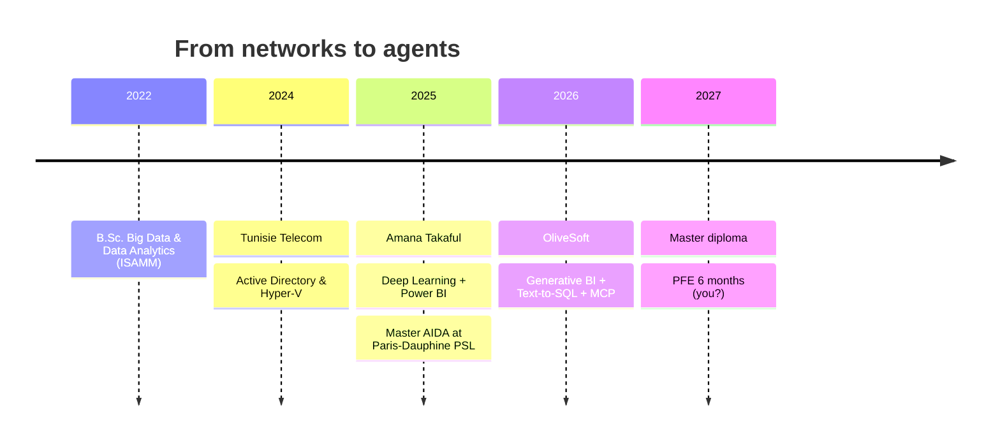
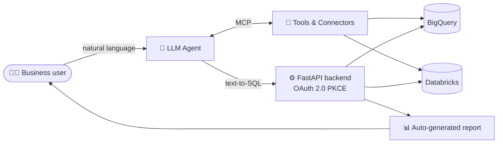

<!-- ============ HEADER ============ -->
<div align="center">


<a href="https://git.io/typing-svg">
  
</a>

<br/>


[](https://linkedin.com/in/cyrine-fakhfakh)
[](mailto:cyrine.fakhfakh@dauphine.eu)


</div>

---

## 🖥️ `whoami`

```bash
$ whoami
cyrine_fakhfakh

$ cat about.json
{
  "role": "Data & AI Engineer in the making",
  "studying": "Master AIDA (AI, Data & Agentic Systems) @ Paris-Dauphine PSL",
  "previously": "B.Sc. Big Data & Data Analytics @ ISAMM",
  "superpower": "Turning messy data into decisions (and questions into SQL)",
  "currently_building": ["Generative BI", "LLM agents", "MCP integrations"],
  "languages": ["English", "Français", "العربية"],
  "fuel": "coffee ☕ + gradient descent 📉",
  "open_to": "PFE 6 months · Data Science / AI / ML / Data Engineering · Feb 2027"
}
```

---

## 🎮 Choose your adventure

<details>
<summary><b>🤖 Level 1 — Generative BI & Agentic AI</b> (click to expand)</summary>
<br/>

> *At **OliveSoft** (Jun – Aug 2026) I built a Generative BI platform where business users just… ask.*

```text
👩‍💼 User   : "Which product category grew the most last quarter?"
🧠 Agent  : understands intent → picks the right tools via MCP
🗄️ SQL    : SELECT category, SUM(revenue) ... GROUP BY ... ORDER BY growth DESC;
📊 Result : chart + automated business report, in seconds
```

- 🔤 **Text-to-SQL**: natural language → safe, executable SQL
- 🔌 **Model Context Protocol (MCP)**: connecting agents to company data & tools
- 🔐 **FastAPI + OAuth 2.0 PKCE**: secure multi-cloud data connectors
- ☁️ **GCP · BigQuery · Databricks** plugged into the data & AI platform

</details>

<details>
<summary><b>📈 Level 2 — Predictive Modeling & Deep Learning</b></summary>
<br/>

- 🏦 **Amana Takaful Insurance** (Feb – Jun 2025): trained a deep learning model to predict fiscal indicators, centralized data in **SQL Server**, shipped interactive **Power BI** dashboards and an insurance website
- 🪙 **Crypto Tracker & AI Predictor**: LSTM + XGBoost forecasting, K-Means market segmentation, PCA pipeline, Streamlit app
- 🩺 **Breast Cancer Prediction App**: benign/malignant classifier with live probability scores and Plotly radar charts

</details>

<details>
<summary><b>🛠️ Level 3 — Infra roots</b></summary>
<br/>

Before AI, there was infrastructure: at **Tunisie Telecom** (Summer 2024) I deployed a high-availability **Active Directory**, virtualized servers with **Hyper-V**, and configured **Windows Server, DNS & domain controllers**. Understanding the plumbing makes me a better data engineer. 🔧

</details>

<details>
<summary><b>🌍 Level 4 — Community</b></summary>
<br/>

- 🎨 Founding member & Marketing Lead of **Dauphine DataIn**
- 🤖 Logistics Lead of the **ISAMM Robotics Club**

</details>

---

## 🧰 Tech arsenal

<div align="center">


</div>

### 📊 Skill radar (self-assessed, honest-ish 😄)

| Domain | Level |
|---|---|
| Machine Learning | `█████████░` 90% |
| Deep Learning (CNN · RNN · LSTM) | `████████░░` 80% |
| Python & SQL | `█████████░` 90% |
| Generative AI & Agents | `████████░░` 85% |
| Data Engineering & Cloud | `███████░░░` 75% |
| Statistics & Bayesian methods | `████████░░` 80% |

---

## 🗺️ My journey



---

## 🏗️ Architecture I love building



---

## 📌 Featured projects

| Project | What it does | Stack |
|---|---|---|
| 🪙 **Cryptocurrency Tracker & AI Predictor** | Tracks, clusters and forecasts crypto markets end-to-end | `Python` `Pandas` `Streamlit` `XGBoost` `LSTM` |
| 🩺 **Breast Cancer Prediction App** | Real-time benign/malignant prediction with radar-chart comparisons | `Python` `Streamlit` `Plotly` `ML` |
| 🤖 **Generative BI Platform** | LLM agents + text-to-SQL + MCP for automated reporting | `FastAPI` `MCP` `GCP` `BigQuery` `Databricks` |

> 💡 *Pin your 3 best repositories on your profile so they appear right here.*

---


## 🧠 Fun facts

- 🔎 I turn *"show me last quarter's sales"* into SQL for a living (well, for an internship)
- 🧪 I believe every model deserves a proper cross-validation
- 🤝 Co-founder energy: I helped start **Dauphine DataIn**
- 🌐 I think in three languages: English, Français, العربية

---

## 🚀 Let's work together!

<div align="center">

### I'm looking for a **6-month PFE starting February 2027**
**Data Science · AI · Machine Learning · Data Engineering**

[](https://linkedin.com/in/cyrine-fakhfakh)
[](mailto:cyrine.fakhfakh@dauphine.eu)


*⭐ If you liked this profile, leave a star, it feeds my loss function.*

</div>
